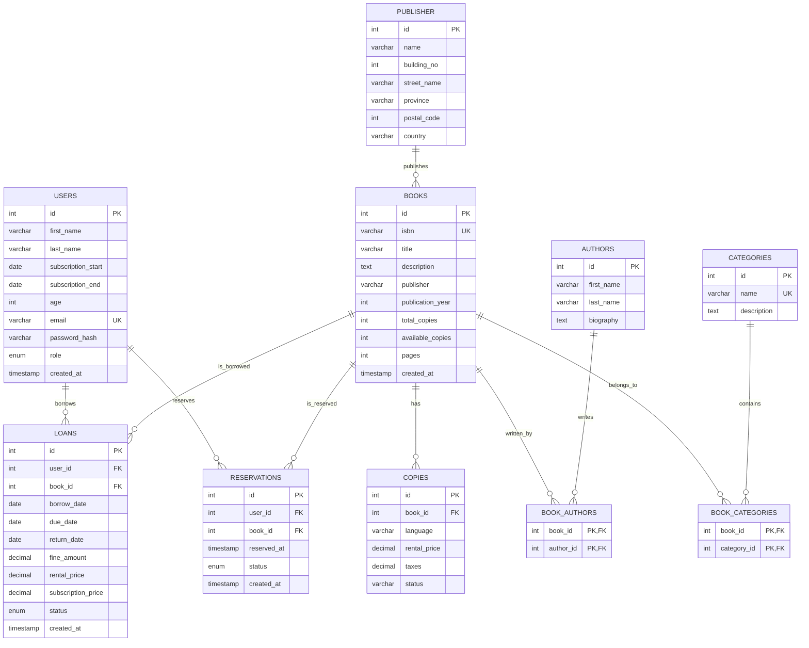

# 📚 Library Management System


## ✨ Features

- **User management**: members, librarians, and admins with role-based access
- **Subscriptions**: track subscription start and end dates per user
- **Book catalog**: ISBN, publisher, description, page count, authors, and categories
- **Physical copies**: per-copy language, rental price, taxes, and status
- **Loans**: borrow/return tracking with due dates and automatic fine calculation
- **Reservations**: reserve books that are currently unavailable
- **Data integrity**: foreign keys, unique and check constraints, triggers, and indexes on key columns


## 🗄️ Database Design

### Entity Relationship Diagram



### Tables

| Table | Purpose |
|-------|---------|
| `users` | Members, librarians, and admins (`role`: member / librarian / admin) |
| `books` | Catalog entries (title, ISBN, publisher, pages, copy counts) |
| `copies` | Individual physical copies of a book (language, price, taxes, status) |
| `authors` | Author details and biography[ |
| `categories` | Genres / categories |
| `book_authors` | Junction table: books ↔ authors (M:N) |
| `book_categories` | Junction table: books ↔ categories (M:N) |
| `loans` | Borrowing transactions (`status`: borrowed / returned / overdue)|
| `reservations` | Book reservations (`status`: active / cancelled / fulfilled) |
| `publisher` | Publisher details and address |

### Constraints

- **Primary keys**: every table has an auto-generated `id` junction tables use composite keys
- **Foreign keys**: `ON DELETE CASCADE` or `RESTRICT` depending on business rules
- **Unique**: `users.email`, `books.isbn`, `categories.name`
- **Checks**:
  - `books.available_copies >= 0 AND books.available_copies <= books.total_copies`
  - `loans.due_date >= loans.borrow_date`
  - `loans.fine_amount >= 0 AND loans.rental_price >= 0 AND loans.subscription_price >= 0`
  - `users.subscription_end >= users.subscription_start`

### Indexes

```sql
-- Search
CREATE INDEX idx_books_title ON books(title);
CREATE INDEX idx_books_isbn ON books(isbn);
CREATE INDEX idx_authors_name ON authors(last_name, first_name);
CREATE INDEX idx_publisher_name ON publisher(name);

-- Foreign keys & Junction tables
CREATE INDEX idx_copies_book_id ON copies(book_id);
CREATE INDEX idx_book_authors_author_id ON book_authors(author_id);
CREATE INDEX idx_book_categories_category_id ON book_categories(category_id);
CREATE INDEX idx_loans_user_id ON loans(user_id);
CREATE INDEX idx_loans_book_id ON loans(book_id);
CREATE INDEX idx_reservations_user_id ON reservations(user_id);
CREATE INDEX idx_reservations_book_id ON reservations(book_id);

-- Status & Date filtering
CREATE INDEX idx_copies_status ON copies(status);
CREATE INDEX idx_loans_status ON loans(status);
CREATE INDEX idx_loans_due_date ON loans(due_date);
CREATE INDEX idx_reservations_status ON reservations(status);
```


### Normalization

The schema follows **Third Normal Form (3NF)**: atomic attributes (1NF),
no partial dependencies (2NF),
no transitive dependencies (3NF),
and junction tables to resolve many-to-many relationships.

